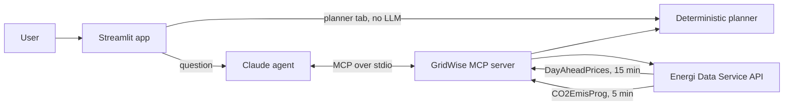

# ⚡ GridWise

**Ask when to charge your EV in Denmark and get the cheapest, greenest time, based on live data from Energinet.**


> "Cheapest and greenest time to charge 40 kWh tonight in DK2? I leave at 07:30."
>
> **Charge 00:30 to 04:15.** Average spot price 0.36 kr/kWh and 66 g CO2/kWh. That is about 31 kr cheaper and 3.5 kg less CO2 than plugging in at 17:00 and charging straight away. (Spot price only: grid tariff, tax and VAT come on top.)

Live demo: coming soon · [Product brief](product/brief.md) · [Decision log](product/decision-log.md)

---

## The problem

Danish electricity prices now change every 15 minutes, and the CO2 intensity of the grid swings by a factor of three or more within a day as wind and imports change. Most EV owners plug in when they get home, which is right at the evening peak. The data to do better is public, but it sits in an API that few people will ever query.

**Target user:** a household in Denmark with an EV and a home charger, who wants to save money and cut emissions without studying the electricity market.

**Job to be done:** *"When I plug in my car this evening, tell me when to charge so it is ready in the morning, at the lowest cost and CO2."*

## What it does

- **Chat (English or Danish):** ask in plain language. A Claude agent picks the right tool, gets real data and answers with a time window, cost and CO2 compared with charging straight away.
- **Planner (no AI needed):** set kWh, charger power, plug-in and ready-by times, and optimise for cheapest, greenest or balanced.
- **MCP server:** the same tools work in Claude Desktop or any other MCP client.

Tools exposed over MCP:

| Tool | What it returns |
|---|---|
| `get_prices` | Day-ahead spot prices for DK1/DK2, hourly summary, cheapest and most expensive quarter |
| `get_co2_forecast` | Forecast CO2 intensity (g/kWh), hourly summary, greenest quarter |
| `plan_ev_charging` | Best continuous charging window, plus cheapest, greenest and "charge now" for comparison |

## How it works



**Design principle: the model talks, the code calculates.** Claude decides which tool to call and explains the result. Every number comes from the planner, which is plain Python with unit tests. See the [decision log](product/decision-log.md) for why.

How the planner picks a window:
1. Merge 15-minute spot prices with the CO2 forecast (averaged from 5 to 15 minutes).
2. Keep slots between plug-in and ready-by. Build every continuous window long enough to deliver the requested kWh.
3. Score each window: `w × normalised price + (1 − w) × normalised CO2`, with `w` = 1 (cheapest), 0 (greenest) or 0.5 (balanced).
4. Compare the winner with the baseline of charging immediately at plug-in.

## Quick start

```bash
git clone https://github.com/mahrukhzulfiqar/gridwise.git
cd gridwise
python -m venv .venv && source .venv/bin/activate
pip install -e ".[app,dev]"

export ANTHROPIC_API_KEY=sk-ant-...      # only needed for chat
streamlit run app.py
```

No API key? The **Charging planner** tab works without one. No internet? Set `GRIDWISE_OFFLINE=1` to use the bundled sample day (synthetic data, clearly labelled in the app).

Ask from the command line:

```bash
python -m gridwise.agent "Hvornår er strømmen billigst i morgen i DK1?"
```

### Use it in Claude Desktop

After `pip install -e .`, add this to `claude_desktop_config.json` and restart Claude Desktop:

```json
{
  "mcpServers": {
    "gridwise": {
      "command": "/full/path/to/gridwise/.venv/bin/gridwise-mcp"
    }
  }
}
```

Then ask Claude: *"Using GridWise, when should I run my dishwasher tonight in Copenhagen?"*

### Deploy the demo (free)

1. Push to GitHub.
2. On [Streamlit Community Cloud](https://share.streamlit.io), create an app from `app.py`.
3. Under *Settings → Secrets*, add `ANTHROPIC_API_KEY = "sk-ant-..."`. Optionally set `GRIDWISE_MODEL`.

## Data

| Dataset | Used for | Resolution |
|---|---|---|
| [DayAheadPrices](https://www.energidataservice.dk/tso-electricity/DayAheadPrices) | Spot price per price area | 15 min (since 1 Oct 2025) |
| [CO2EmisProg](https://www.energidataservice.dk/tso-electricity/CO2EmisProg) | Forecast CO2 intensity | 5 min |

Source: Energinet, [Energi Data Service](https://www.energidataservice.dk). Free, no API key. Data is not endorsed by Energinet. Price areas: **DK1** West Denmark (Jutland, Funen), **DK2** East Denmark (Zealand, Copenhagen).

## Known limitations

- **Spot price is not your bill.** Grid tariff (highest 17:00 to 21:00), electricity tax and VAT come on top. Adding tariffs per grid company is first on the [roadmap](product/roadmap.md).
- **Tomorrow's prices** are usually published early afternoon. Before that, GridWise says so instead of guessing.
- One continuous charging session. Split sessions and smart-charger control are out of scope for v0.1.

## Tests

```bash
pytest          # 19 tests: planner, API client (mocked), MCP server end to end, agent loop (stubbed Claude)
ruff check .
```

CI runs both on every push.

## Product docs

| Doc | |
|---|---|
| [One-page brief](product/brief.md) | Problem, user, scope, risks |
| [Success metrics](product/metrics.md) | What good looks like and how it is measured |
| [Roadmap](product/roadmap.md) | Now, next, later |
| [Decision log](product/decision-log.md) | Key product and technical decisions, with reasoning |

## Repo layout

```
gridwise/
  eds_client.py   Energi Data Service client (prices, CO2 forecast)
  planner.py      Charging window optimiser (pure Python)
  server.py       MCP server exposing the tools
  agent.py        Claude agent that uses the MCP server
app.py            Streamlit UI
product/          Brief, metrics, roadmap, decision log
tests/            pytest suite
data/             Synthetic sample day for offline mode
```

## License

MIT. Built by Mahrukh Zulfiqar.
