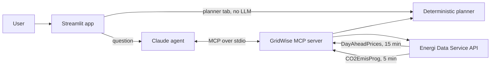

# ⚡ GridWise

**Ask when to charge your EV in Denmark and get the cheapest, greenest time, based on live data from Energinet.**

👉 [**Try the live demo**](https://gridwise-dk.streamlit.app) (no sign-up)

<!-- Demo GIF goes here once recorded:  -->

> "Cheapest and greenest time to charge 40 kWh tonight in DK2? I leave at 07:30."
>
> **Charge 00:30 to 04:15.** Average spot price 0.36 kr/kWh and 66 g CO2/kWh. About 31 kr cheaper and 3.5 kg less CO2 than plugging in at 17:00 and charging straight away. (Spot price only: grid tariff, tax and VAT come on top.)
>
> <sub>Example answer from the bundled sample day.</sub>

## Product case study at a glance

| | |
|---|---|
| **Problem** | Knowing when to charge an EV cheaply and cleanly in Denmark is hard: prices change every 15 minutes, CO2 varies with the wind, and grid tariffs add a daily peak |
| **User** | Started broad (any Danish EV owner with a home charger); [refined after research](product/desk-research.md) to owners with a basic charger and no smart app, plus developers building energy agents |
| **My role** | Defined the problem, scope, success metrics and roadmap; made and logged the product decisions; built and shipped it |
| **Key decision** | The AI explains, tested code calculates: every number is reproducible |
| **After launch** | Adapted within a day when the data provider introduced rate limits; fixed an answer that was correct but misleading |
| **Evidence** | [Desk research](product/desk-research.md) weakened two core assumptions: EV owners already charge at night, and charger apps already automate. Refined the target user and made all-in price a must |
| **Next** | All-in price with grid tariffs, and interviews with the refined segment |

📄 **Product docs:** [One-page brief](product/brief.md) · [Success metrics](product/metrics.md) · [Roadmap](product/roadmap.md) · [Decision log](product/decision-log.md) · [Desk research](product/desk-research.md) · [Discovery plan](product/discovery-plan.md)

The product story comes first below. Architecture, setup and tests are in [For engineers](#for-engineers).

---

# Product

## 1. Problem and user

Danish electricity prices now change every 15 minutes, the CO2 intensity of the grid swings through the day with wind and imports, and grid tariffs are highest between 17:00 and 21:00. Getting the timing right means combining all three, and the data sits in an API few people will ever query.

**What research changed:** I started from the assumption that most EV owners plug in and charge at the evening peak. [Desk research](product/desk-research.md) showed that many have already moved to night charging since the 2023 tariff change, and that charger apps already automate it. So the target user narrowed.

**Target user:** a household in Denmark with an EV and a **basic home charger without a smart charging app**, who wants to save money and cut emissions without studying the electricity market. Second segment: **developers and energy teams** who want price and CO2 planning as tools for their own AI agents (MCP).

**Job to be done:** *"When I plug in my car this evening, tell me when to charge so it is ready in the morning, at the lowest cost and CO2."*

**Deliberately out of scope for v0.1:** controlling the charger, other appliances, user accounts. One job, done well. ([brief](product/brief.md))

## 2. Key product decisions

| Decision | Why | Trade-off |
|---|---|---|
| **The model talks, the code calculates** ([D2](product/decision-log.md#d2-the-model-talks-the-code-calculates)) | Users act on money and CO2 numbers, so they must be reproducible and testable. The AI picks the tool and explains; a tested planner does the maths, and every tool call is shown. | Less flexible for unusual questions |
| **Ship spot price only, and say so in every answer** ([D5](product/decision-log.md#d5-ship-with-spot-price-only-and-say-so-every-time)) | A trusted, working loop first. The limitation is visible, never hidden. | Savings shown differ from the real bill near the 17:00 to 21:00 tariff peak |
| **One continuous charging window** ([D6](product/decision-log.md#d6-recommend-one-continuous-window)) | Matches how people and chargers schedule charging; easy to act on | Leaves a small saving on the table some nights |
| **State defaults instead of asking** ([D8](product/decision-log.md#d8-state-defaults-instead-of-asking)) | One useful answer beats a round of clarifying questions | Assumption may be wrong; the answer says what was assumed |
| **Works without AI** ([D7](product/decision-log.md#d7-a-planner-that-works-without-the-llm)) | Anyone can try it free; fallback if the model API is down; proves the value is in the planner | Chat is optional, not the hero |

## 3. What changed after launch

The first live run surfaced two problems that no test caught:

- **The data provider changed its rules.** Energinet had introduced per-dataset rate limits, and the app was blocked within seconds. I redesigned data access: one call per dataset instead of one per day, a 15-minute cache, and honouring the provider's wait time. ([D10](product/decision-log.md#d10-design-for-the-data-providers-rate-limits))
- **A correct answer can still mislead.** Before tomorrow's prices are published (around 13:00), the planner recommended the best slot *this evening*, which is the peak. It now says clearly what it can and cannot see yet.

## 4. How I measure success

**North star:** saving per charging session versus plugging in and charging immediately, in DKK and kg CO2. It measures value to the user, not engagement.
**Trust guardrail:** 100% of numbers in answers come from a tool call. More in [metrics.md](product/metrics.md).

## 5. What's next

- **Next:** all-in price (grid tariff per grid company, tax, VAT); an eval set of 25 labelled questions; user interviews with EV owners
- **Later:** schedule the charger directly; notify when tomorrow's prices are out; other flexible loads (heat pump, dishwasher)

Full [roadmap](product/roadmap.md). Assumptions still to validate are listed in the [brief](product/brief.md#key-assumptions-to-test).

## 6. Try it

- **[Live demo](https://gridwise-dk.streamlit.app)**: the *Charging planner* tab works for anyone, no sign-up.
- **Chat (English or Danish):** ask in plain language; a Claude agent answers with a time window, cost and CO2. Runs locally with your own API key.
- **MCP server:** the same tools work in Claude Desktop or any MCP client.

---

# Engineering

## For engineers

| Tool (MCP) | What it returns |
|---|---|
| `get_prices` | Day-ahead spot prices for DK1/DK2, hourly summary, cheapest and most expensive quarter |
| `get_co2_forecast` | Forecast CO2 intensity (g/kWh), hourly summary, greenest quarter |
| `plan_ev_charging` | Best continuous charging window, plus cheapest, greenest and "charge now" for comparison |

### Architecture



**Design principle: the model talks, the code calculates.** Claude decides which tool to call and explains the result. Every number comes from the planner, which is plain Python with unit tests. See the [decision log](product/decision-log.md) for why.

How the planner picks a window:
1. Merge 15-minute spot prices with the CO2 forecast (averaged from 5 to 15 minutes).
2. Keep slots between plug-in and ready-by. Build every continuous window long enough to deliver the requested kWh.
3. Score each window: `w × normalised price + (1 − w) × normalised CO2`, with `w` = 1 (cheapest), 0 (greenest) or 0.5 (balanced).
4. Compare the winner with the baseline of charging immediately at plug-in.

### Run it locally

```bash
git clone https://github.com/mahrukhzulfiqar/gridwise.git
cd gridwise
python -m venv .venv && source .venv/bin/activate
pip install -e ".[app,dev]"

export ANTHROPIC_API_KEY=sk-ant-...      # only needed for chat
streamlit run app.py
```

No API key? The **Charging planner** tab works without one. No internet? Set `GRIDWISE_OFFLINE=1` to use the bundled sample day (synthetic data, clearly labelled in the app).

Ask from the command line:

```bash
python -m gridwise.agent "Hvornår er strømmen billigst i morgen i DK1?"
```

#### Use it in Claude Desktop

After `pip install -e .`, add this to `claude_desktop_config.json` and restart Claude Desktop:

```json
{
  "mcpServers": {
    "gridwise": {
      "command": "/full/path/to/gridwise/.venv/bin/gridwise-mcp"
    }
  }
}
```

Then ask Claude: *"Using GridWise, when should I run my dishwasher tonight in Copenhagen?"*

#### Deploy the demo (free)

1. Push to GitHub.
2. On [Streamlit Community Cloud](https://share.streamlit.io), create an app from `app.py`.
3. Under *Settings → Secrets*, add `ANTHROPIC_API_KEY = "sk-ant-..."`. Optionally set `GRIDWISE_MODEL`.

### Data

| Dataset | Used for | Resolution |
|---|---|---|
| [DayAheadPrices](https://www.energidataservice.dk/tso-electricity/DayAheadPrices) | Spot price per price area | 15 min (since 1 Oct 2025) |
| [CO2EmisProg](https://www.energidataservice.dk/tso-electricity/CO2EmisProg) | Forecast CO2 intensity | 5 min |

Source: Energinet, [Energi Data Service](https://www.energidataservice.dk). Free, no API key. Data is not endorsed by Energinet. Price areas: **DK1** West Denmark (Jutland, Funen), **DK2** East Denmark (Zealand, Copenhagen).

### Known limitations

- **Spot price is not your bill.** Grid tariff (highest 17:00 to 21:00), electricity tax and VAT come on top. Adding tariffs per grid company is first on the [roadmap](product/roadmap.md).
- **Tomorrow's prices** are usually published early afternoon. Before that, GridWise says so instead of guessing.
- One continuous charging session. Split sessions and smart-charger control are out of scope for v0.1.

### Tests

```bash
pytest          # 22 tests: planner, API client (mocked), MCP server end to end, agent loop (stubbed Claude)
ruff check .
```

CI runs both on every push.

### Repo layout

```
gridwise/
  eds_client.py   Energi Data Service client (prices, CO2 forecast)
  planner.py      Charging window optimiser (pure Python)
  server.py       MCP server exposing the tools
  agent.py        Claude agent that uses the MCP server
app.py            Streamlit UI
product/          Brief, metrics, roadmap, decision log
tests/            pytest suite
data/             Synthetic sample day for offline mode
```

## About

MIT license. Built by Mahrukh Zulfiqar, Product Manager (data and AI), Copenhagen.
