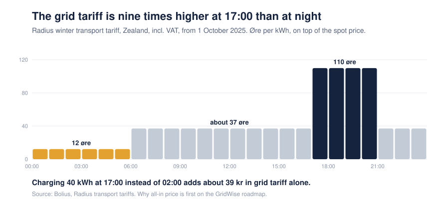

# Desk research: EV charging behaviour in Denmark

**Type:** secondary research (published studies, statistics, competitor products, public forums). **Not** user interviews.
**Date:** November 2026 · **Owner:** Mahrukh Zulfiqar
**Purpose:** test the assumptions in the [brief](brief.md) with existing evidence before running [interviews](discovery-plan.md).

## Summary

| Assumption | Evidence | Status |
|---|---|---|
| EV owners charge at the evening peak | Grid data shows EV owners already moved charging to the night after time-of-use tariffs arrived in 2023 | ❌ **Weakened** |
| Spot-price timing saves the user money | Most Danish electricity agreements are variable-price, but a sizeable minority are fixed | ✅ **Mostly holds** |
| There is a gap to fill | Several charger and energy apps already auto-schedule charging by price | ❌ **Weakened** |
| Users respond to price signals | A survey of 500 Danish EV owners found most check prices and are willing to postpone charging | ✅ **Holds** |
| Spot price is the number that matters | The grid tariff difference between peak and night is often larger than the spot-price difference | ❌ **Wrong**: all-in price matters more |

## Findings

### 1. Behaviour has already shifted to the night
Radius, the grid company for Greater Copenhagen, reported in February 2023 that EV owners had become "night owls": charging between 17:00 and 21:00 fell below average, and night-time charging rose sharply after the new tariff model came in.
**Implication:** the "plug in at 17:00 and charge straight away" baseline in GridWise is less common than assumed. The savings figure is real for people who don't plan their charging, but that group is smaller than it was.

### 2. Most, but not all, households can benefit from timing
Green Power Denmark reported that 69% of electricity agreements in Denmark in 2023 were variable-price, up from 43% in 2021.
**Implication:** roughly a third of households are on fixed prices, and for them the timing of spot prices doesn't matter (the grid tariff still does). GridWise should ask about, or explain, the contract type.

### 3. The grid tariff is often the bigger lever
Radius's winter transport tariff (incl. VAT, from 1 Oct 2025) was 12.20 øre/kWh at night (00 to 06) and 109.85 øre/kWh in the peak (17 to 21), a difference of almost 1 kr/kWh, every day, regardless of wind and weather.

**Implication:** confirms **all-in price** as the top roadmap item. A spot-only recommendation can be right on spot price and still wrong on the bill.

### 4. Competitors already automate
Charger and energy apps such as Monta, Clever, True Energy and Gridio offer smart charging that schedules home charging by price automatically. Clever removed the spot-price display for customers without its electricity product because it caused more confusion than benefit.
**Implications:**
- Advice alone ("charge at 00:30") is weaker than automation for people who already have a smart charger.
- Showing raw spot prices can confuse users. This supports GridWise's rule of always saying what the number does and doesn't include, and argues for all-in prices.

### 5. Users are price-aware and flexible
A DTU study surveyed 500 Danish EV owners who can schedule their charging. Most regularly check electricity prices, and many are willing to postpone charging by a day or more. Price responsiveness varies between users.
**Caveat:** the sample is people who already have scheduled charging, so it likely over-represents engaged users.

### 6. Enthusiasts build this themselves
A Danish EV owner shared a Home Assistant setup that finds the cheapest continuous charging window before a target time, which is the same logic as the GridWise planner, applied to a basic charger.
**Implication:** there is a technical segment (basic charger, Home Assistant, developers) that wants this as a building block, not an app.

## What this changes

1. **Target user, refined:** households with a **basic charger and no smart charging app**, and developers or energy companies who want price and CO2 planning as **tools for their own agents (MCP)**. Owners who already use Monta, Clever and similar apps are a weaker fit.
2. **Priority confirmed:** all-in price (grid tariff, tax, VAT) moves from "important" to "required for the recommendation to be trustworthy".
3. **Baseline to revisit:** compare against "charge at the cheapest grid-tariff time" as well as "charge at plug-in", so savings aren't overstated.
4. **Interview focus:** the [interviews](discovery-plan.md) should now test the refined segment: people with basic chargers, and developers or energy teams who might use the MCP tools.

## Sources
- Radius Elnet, press release 10 Feb 2023: EV owners shift charging to the night. https://via.ritzau.dk/pressemeddelelse/13670582/elbilister-er-blevet-natteravne---flytter-deres-forbrug-og-sparer-penge?publisherId=13560695
- Green Power Denmark via Ritzau/DOI, Jul 2025: share of variable-price agreements. https://www.doi.dk/en/ptx/artikel/slut-med-timepriser-snart-kan-elprisen-skifte-hvert-kvarter
- Bolius, Radius transport tariffs incl. VAT from 1 Oct 2025. https://www.bolius.dk/hoejere-afgift-om-vinteren-dyrere-at-lave-mad-om-aftenen-98479
- DTU, "Which electric vehicle users are flexible and price-responsive?", Energy Research & Social Science 127 (2025). https://orbit.dtu.dk/en/publications/which-electric-vehicle-users-are-flexible-and-price-responsive-un/
- Monta home charging: https://monta.com/uk/home-charging/ · Clever app: https://apps.apple.com/ms/app/clever-a-s/id1359124777 · True Energy app: https://apps.apple.com/dk/app/id1477314939 · Gridio app: https://apps.apple.com/dk/app/gridio/id1572829126?l=da
- The Cooldown on a Danish EV owner's Home Assistant setup (from r/HomeAssistant): https://www.thecooldown.com/?p=804018
